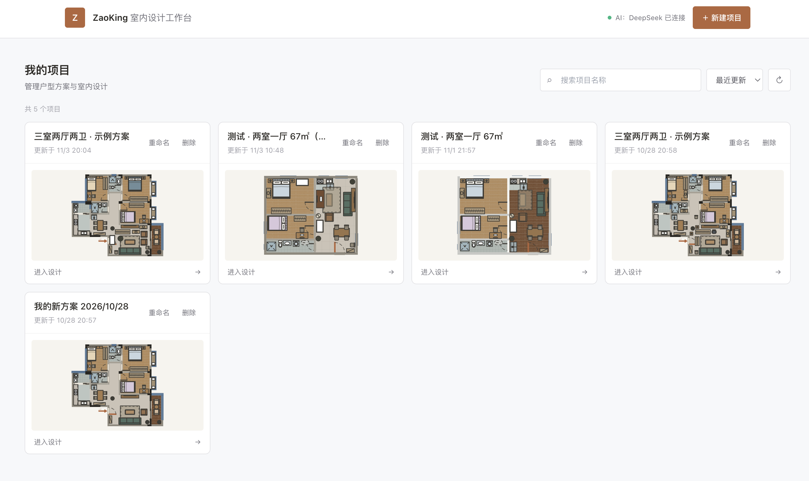
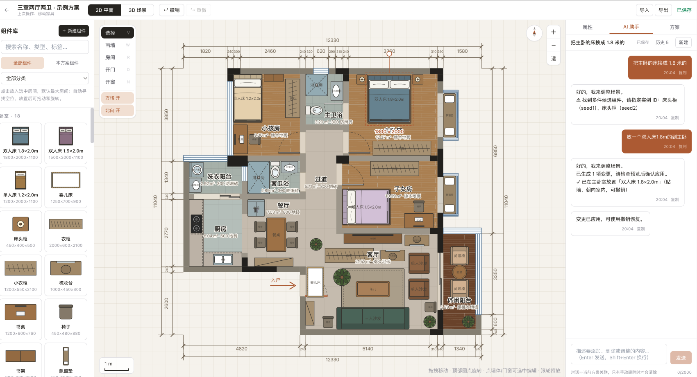
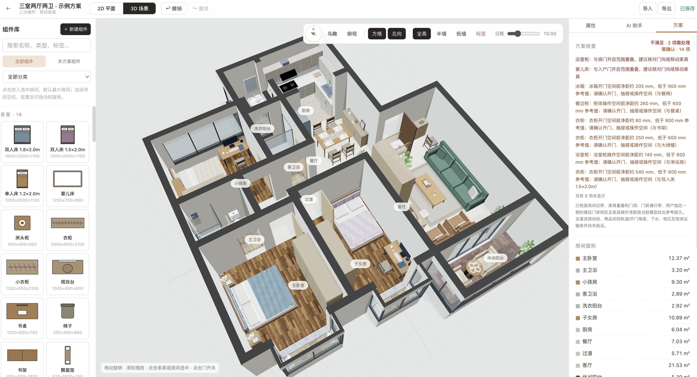

# ZaoKing | AI 辅助室内设计工作台

[简体中文](README.md) · [English](README_EN.md)

ZaoKing 是一款面向装修业主与独立设计师的 Web 室内设计工具。它把户型编辑、家具布置、材质调整和 AI 辅助设计放在同一个工作流中，并让 2D 平面图与 3D 场景共享同一份设计数据。

> 项目仍在积极开发中。目前提供可运行的设计工作台原型，功能和数据模型持续迭代。

## 产品预览

### 项目工作台



### 2D 户型设计



### 3D 空间预览



## 功能概览

- **户型编辑**：在 2D 画布中编辑房间、墙体、门窗和尺寸标注，并通过网格与朝向辅助定位。
- **2D / 3D 联动**：以统一的场景文档保存户型和家具数据，在平面编辑与 3D 空间预览间切换。
- **家具与组件**：从组件库放置家具，调整位置、朝向和长宽高；支持自定义组件与材质。
- **AI 设计助手**：通过自然语言提出设计修改，AI 将请求转换为结构化操作，并由应用校验和应用。
- **户型截图识别**：配置视觉模型后，可上传户型截图生成可继续编辑的户型草稿。
- **方案与数据包**：保存项目和 AI 对话，导入或导出参数化设计数据包。
- **空间检查**：提示家具与门扇、通行空间等布局问题，帮助用户在方案阶段发现冲突。
- **3D 材质**：使用 PBR 地面贴图和 HDRI 环境光呈现更具层次的空间预览。

## 技术栈

| 层次 | 技术 |
| --- | --- |
| Web 应用 | Next.js 14 App Router、React 18、TypeScript、Tailwind CSS |
| 2D / 3D | React 画布、Three.js、React Three Fiber、Drei |
| 状态管理 | Zustand |
| 服务端与数据 | Next.js Route Handlers、Prisma、SQLite（本地默认配置） |
| AI 与校验 | DeepSeek 兼容 API、视觉模型兼容 API、Zod |
| 测试 | Vitest |

## 本地开发

### 环境要求

- Node.js 20 或更新的 LTS 版本
- npm

### 安装与启动

```bash
git clone https://github.com/osbrain/ZaoKing.git
cd ZaoKing
cp .env.example .env
npm install
npx prisma db push
npm run dev
```

打开 [http://localhost:3000](http://localhost:3000)。

### AI 配置

编辑本地 `.env`：

```dotenv
DEEPSEEK_API_KEY=你的DeepSeek密钥
VISION_API_KEY=你的视觉模型密钥
```

`DEEPSEEK_API_KEY` 用于文本设计助手；`VISION_API_KEY` 用于户型截图识别。视觉服务的模型和兼容接口地址可通过 `.env.example` 中的 `VISION_MODEL`、`VISION_BASE_URL` 配置。密钥只应保存在本地或部署平台的环境变量中，不要提交到 Git。

不配置 AI 密钥时，项目的非 AI 页面和设计工作流仍可用于本地开发；AI 功能需要配置对应服务凭据。

## 常用命令

```bash
npm run dev        # 启动开发服务
npm run typecheck  # TypeScript 类型检查
npm test           # 运行单元测试
npm run build      # 创建生产构建
npm start          # 启动生产服务
```

## 项目结构

```text
src/
  app/                    页面与 API Route Handlers
  core/                   场景模型、Schema、几何、命令与布局校验
  features/               编辑器、画布、AI 助手、组件库等功能模块
  lib/                    数据库、AI Provider、API 与自动保存服务
  stores/                 Zustand 场景与编辑器状态
tests/unit/               按领域、功能和 API 组织的单元测试
prisma/                   Prisma 数据模型
public/textures/          3D 地面与环境贴图
docs/images/              README 产品截图
```

## 设计数据与部署说明

2D 和 3D 视图围绕同一份场景文档工作。墙体、房间、开口、材质和家具实例以结构化数据保存；画布负责将这些数据映射为平面图和 3D 场景。AI 生成的修改也会先转为受 Schema 约束的设计操作，再由场景逻辑校验。

仓库中的 Prisma schema 默认使用 SQLite，适合本地开发和原型验证。正式部署前，需要根据部署环境选择数据库、配置连接与迁移策略，并评估文件存储、认证、权限、备份和 AI 服务配额。当前仓库不应被视为已完成生产部署加固的 SaaS 服务。

## 许可证与素材

目前仓库尚未添加项目代码许可证。除非仓库另行添加许可证，项目代码默认不授予复用、修改或分发权限。3D 环境与地面素材的来源及许可说明见 [`public/textures/README.md`](public/textures/README.md)。
