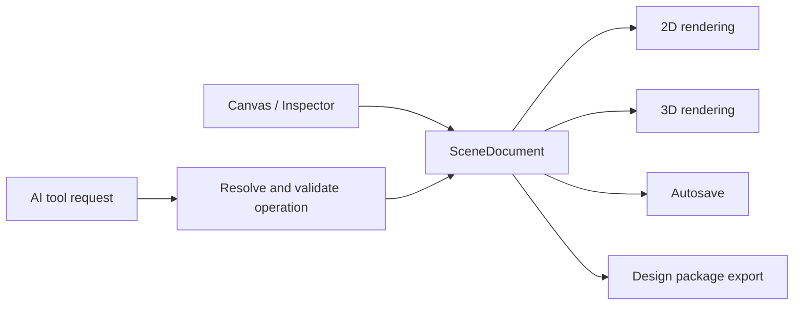

# ZaoKing

### AI-Assisted Interior Design Workspace

[English](README.md) · [简体中文](README_ZH.md)

ZaoKing is a web-based interior design workspace for homeowners and independent designers. It brings floor-plan editing, furniture layout, material editing, and AI-assisted changes into one workflow. The 2D plan and 3D scene are projections of the same structured design document.

> **Project status:** ZaoKing is under active development. This repository contains a working product prototype. Features, data models, and APIs may change as the project evolves.

## Product Preview

### Project Dashboard

Manage design projects and open a floor plan in the editor.


### 2D Floor-Plan Editor

Edit rooms, walls, openings, dimensions, and furniture, with the AI assistant available alongside the canvas.


### 3D Scene Preview

Inspect room structure, furniture placement, materials, and spatial checks in a synchronized 3D view.


## What You Can Do

- **Create and edit floor plans.** Work with rooms, walls, doors, windows, openings, dimensions, a toggleable grid, and orientation indicators.
- **Switch between layout and floor-finish layers.** Configure room-specific tile size, grout, laying pattern, and start point; compare material quantity and cost estimates. Floor mode hides furniture and disables furniture placement and structural drawing tools while keeping the plan context visible.
- **Plan renovation work.** Mark walls as retained, new, or demolished; see matching 2D symbols and 3D previews, and ask the AI assistant to change a wall by ID. Structural wall demolition is flagged for professional review.
- **Control the canvas display.** Toggle room labels and furniture visibility in both 2D and 3D views.
- **Move between 2D and 3D.** Edit a plan and inspect the corresponding room layout in a 3D scene backed by the same design data.
- **Arrange and customize furniture.** Add catalog components, place and rotate them, adjust width, depth, and height, and edit supported component parameters.
- **Estimate a project budget.** Set project-specific floor-material prices and actual unit prices for placed furniture; the estimate marks unpriced furniture instead of silently counting it as free.
- **Ask the AI assistant to make changes.** Describe additions, deletions, replacements, moves, size changes, colors, or floor materials in natural language.
- **Import a floor-plan image.** Use a configured vision model to create a draft from an uploaded screenshot, then review and edit the recognized geometry.
- **Check a layout.** Surface selected furniture clearance and door-swing conflicts while arranging a room.
- **Save and exchange design data.** Persist projects and conversations locally and import or export parameterized design packages.
- **Preview materials in 3D.** Use PBR floor textures and HDRI-based environment lighting.

AI recognition and layout checks are design aids. They do not certify measurements, accessibility, code compliance, structural safety, or construction feasibility. Verify important dimensions and site conditions with qualified professionals before purchasing or building.

## How the Design Data Works

The editor keeps a structured `SceneDocument` as the source for the design. It contains levels, walls, rooms, openings, furniture instances, and optional project-specific asset and material snapshots. Measurements are stored in millimeters. Walls can carry an optional renovation state (`new` or `demolished`); a missing state means retained, so older documents need no migration. A room can store an optional floor-finish override for tile dimensions, grout, laying pattern, and world-space origin; older rooms continue to use their material defaults. Placed furniture can carry an instance-specific unit price, and material snapshots can retain project-specific prices. The 2D canvas and the Three.js scene render the same geometry while sharing editor display controls.

The main interaction flow is:



For AI changes, the server sends the current room and component context to a compatible language model. The model can request a defined tool such as adding, resizing, deleting, or recoloring an item. The application resolves that request against the asset catalog, validates supported fields and layout constraints, then applies the resulting operation. Screenshot recognition is a separate vision workflow that returns a draft for user review.

## Budget Estimate Limits

The estimate combines each room's floor area with a layout-based material allowance (5% for straight laying, 8% for brick laying, and 12% for diagonal laying) and the project-configured price per square meter. It also estimates tile or plank count from the configured format. These are planning assumptions, not a construction takeoff: cuts, substrate conditions, product packaging, labor, accessories, delivery, installation, discounts, and taxes are not modeled. Unpriced furniture is listed separately and excluded from the subtotal. Built-in material prices are editable references, and the component catalog is not connected to live retailer SKUs.

## Technology

| Area | Stack |
| --- | --- |
| Web application | Next.js 14 App Router, React 18, TypeScript, Tailwind CSS |
| Scene rendering | Three.js, React Three Fiber, Drei |
| Client state | Zustand |
| Server APIs | Next.js Route Handlers |
| Persistence | Prisma ORM with SQLite by default |
| Validation | Zod and shared scene / asset schemas |
| AI providers | DeepSeek-compatible text API; configurable vision API; optional OpenAI-compatible text provider |
| Tests | Vitest |

## Run Locally

### Requirements

- Node.js 20 or a newer LTS release
- npm

### Install

```bash
git clone https://github.com/osbrain/ZaoKing.git
cd ZaoKing
cp .env.example .env
npm install
npx prisma db push
npm run dev
```

Open [http://localhost:3000](http://localhost:3000).

The local Prisma schema uses SQLite. The development database is created at `prisma/dev.db` and is ignored by Git.

### Configure AI

Add provider credentials to `.env` on your machine:

```dotenv
DEEPSEEK_API_KEY=your_deepseek_api_key
VISION_API_KEY=your_vision_model_api_key
```

- `DEEPSEEK_API_KEY` enables the text design assistant. The base URL and model can be set with `DEEPSEEK_BASE_URL` and `DEEPSEEK_MODEL`.
- `VISION_API_KEY` enables floor-plan screenshot recognition. The default provider is configured for Qwen3-VL-Plus. Override it with `VISION_BASE_URL` and `VISION_MODEL` if using another compatible vision endpoint.
- `OPENAI_API_KEY`, `OPENAI_BASE_URL`, and `OPENAI_MODEL` are available for the optional OpenAI-compatible text provider.
- `DATABASE_URL` defaults to the local SQLite file shown in `.env.example`.

Keep API keys in local or deployment environment variables. Never commit `.env` or paste provider credentials into issues, screenshots, or source files. AI features require their respective provider credentials; the rest of the local prototype can be explored without them.

## Development Commands

```bash
npm run dev        # Start the development server
npm run typecheck  # Run the TypeScript type check
npm test           # Run unit tests
npm run build      # Create a production build
npm start          # Start the production server
```

The development server and production build both use `.next`. Stop the development server before running `npm run build`, then restart it when you return to development.

## Repository Layout

```text
src/
  app/                       Pages and API Route Handlers
  core/                      Scene document, schemas, geometry, operations, validation
  features/                  Editor, 2D / 3D canvases, AI chat, library, inspector
  lib/                       Database, AI providers, API and autosave helpers
  stores/                    Zustand scene and editor state
tests/unit/                  Tests grouped by domain, feature and API
prisma/                      Prisma schema and local development database
public/textures/              3D floor and environment textures
docs/images/                 README screenshots
```

The domain logic in `src/core` is kept independent of React where practical, so scene schemas, geometry, layout rules, and operations can be shared by the editor and server-side AI workflows.

## Current Scope and Deployment Notes

The repository is a development prototype, not a production-hardened hosted service. SQLite is the default local persistence setup. A production deployment needs an intentional database and migration strategy, authentication and project authorization, persistent file storage for uploads, backups, observability, rate limits, and controls for AI cost and availability. Review the upload and provider limits for the deployment environment before exposing the service publicly.

The screenshot importer produces a draft from model output; users should review room boundaries, dimensions, doors, and windows before relying on it. The current spatial checks cover selected layout constraints and are not a substitute for a complete building-code or construction-planning engine.

## License

ZaoKing project code is licensed under the [Apache License 2.0](LICENSE). Third-party textures and other assets can have separate terms; see [`public/textures/README.md`](public/textures/README.md) and the notices shipped with each asset. The project license does not grant rights to third-party brands or services.

## Contributing

Issues and pull requests are welcome. For a useful bug report, include the affected workflow, reproducible steps, expected and actual behavior, and relevant browser or server errors. Remove personal floor plans, API keys, and other private data before attaching logs or screenshots.
