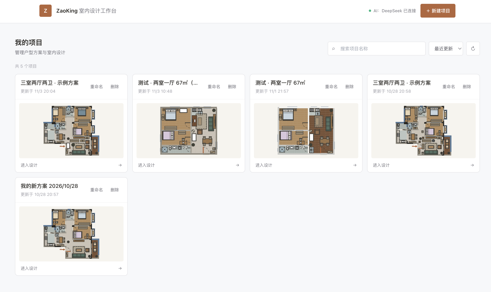
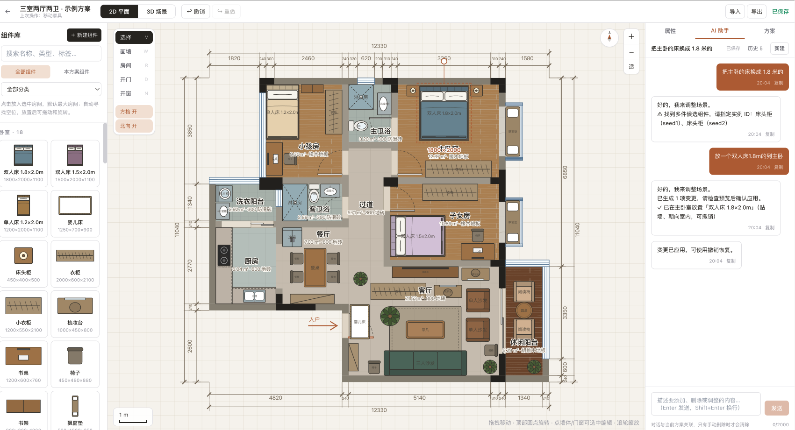
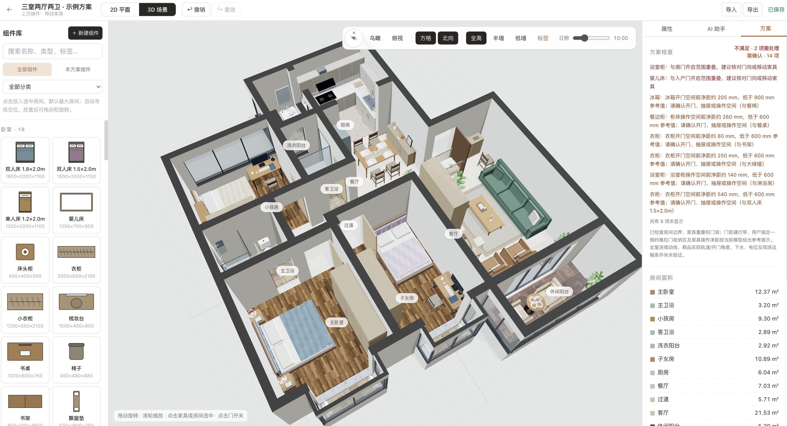

# ZaoKing | AI-Assisted Interior Design Workspace

[简体中文](README.md) · [English](README_EN.md)

ZaoKing is a web-based interior design tool for homeowners and independent designers. It brings floor-plan editing, furniture layout, material editing, and AI-assisted design into one workflow. The 2D plan and 3D scene are driven by the same structured design document.

> ZaoKing is under active development. The repository currently provides a working design-workspace prototype, and its features and data model continue to evolve.

## Product Preview

### Project Dashboard



### 2D Floor-Plan Editor



### 3D Scene Preview



## Features

- **Floor-plan editing**: Edit rooms, walls, doors, windows, and dimension annotations on a 2D canvas, with grid and orientation aids.
- **Synchronized 2D and 3D views**: Keep the floor plan and 3D preview in sync through a shared scene document.
- **Furniture and components**: Place catalog items and adjust position, rotation, width, depth, and height. Custom components and materials are supported.
- **AI design assistant**: Describe design changes in natural language. Requests are converted into structured operations and validated by the application.
- **Floor-plan image import**: Configure a vision model to turn an uploaded floor-plan image into an editable draft.
- **Projects and design packages**: Save projects and AI conversations, and import or export parameterized design packages.
- **Spatial checks**: Surface layout issues involving furniture, door swings, and circulation space during planning.
- **3D materials**: Use PBR floor textures and HDRI environment lighting for a more detailed scene preview.

## Tech Stack

| Layer | Technologies |
| --- | --- |
| Web application | Next.js 14 App Router, React 18, TypeScript, Tailwind CSS |
| 2D / 3D | React canvas, Three.js, React Three Fiber, Drei |
| State management | Zustand |
| Server and data | Next.js Route Handlers, Prisma, SQLite (default local setup) |
| AI and validation | DeepSeek-compatible API, vision-model-compatible API, Zod |
| Testing | Vitest |

## Local Development

### Prerequisites

- Node.js 20 or a newer LTS release
- npm

### Install and run

```bash
git clone https://github.com/osbrain/ZaoKing.git
cd ZaoKing
cp .env.example .env
npm install
npx prisma db push
npm run dev
```

Open [http://localhost:3000](http://localhost:3000).

### AI configuration

Add your credentials to the local `.env` file:

```dotenv
DEEPSEEK_API_KEY=your_deepseek_api_key
VISION_API_KEY=your_vision_model_api_key
```

`DEEPSEEK_API_KEY` enables the text design assistant. `VISION_API_KEY` enables floor-plan image recognition. The vision model and compatible endpoint can be configured with `VISION_MODEL` and `VISION_BASE_URL`; see `.env.example` for the available settings. Keep credentials in local or deployment environment variables and never commit them to Git.

The non-AI pages and design workflow can be used for local development without AI credentials. AI features require credentials for their respective services.

## Useful Commands

```bash
npm run dev        # Start the development server
npm run typecheck  # Run the TypeScript type check
npm test           # Run unit tests
npm run build      # Create a production build
npm start          # Start the production server
```

## Project Structure

```text
src/
  app/                    Pages and API Route Handlers
  core/                   Scene model, schemas, geometry, commands, and layout checks
  features/               Editor, canvases, AI assistant, component library, and more
  lib/                    Database, AI providers, API, and autosave services
  stores/                 Zustand scene and editor state
tests/unit/               Unit tests grouped by domain, feature, and API
prisma/                   Prisma data model
public/textures/          3D floor and environment textures
docs/images/              README product screenshots
```

## Design Data and Deployment

The 2D and 3D views use one scene document. Structured data represents walls, rooms, openings, materials, and furniture instances; each canvas maps that data to its respective view. AI changes are converted into schema-constrained design operations before scene logic validates them.

The Prisma schema uses SQLite by default, which is suitable for local development and prototyping. Before production deployment, select a database for the target environment and define connection, migration, file-storage, authentication, authorization, backup, and AI-usage policies. This repository should not be considered a production-hardened SaaS deployment.

## License and Assets

No license has been added for the project code. Unless a license is added to the repository, the code is not granted for reuse, modification, or redistribution. Sources and license information for the 3D environment and floor textures are documented in [`public/textures/README.md`](public/textures/README.md).
