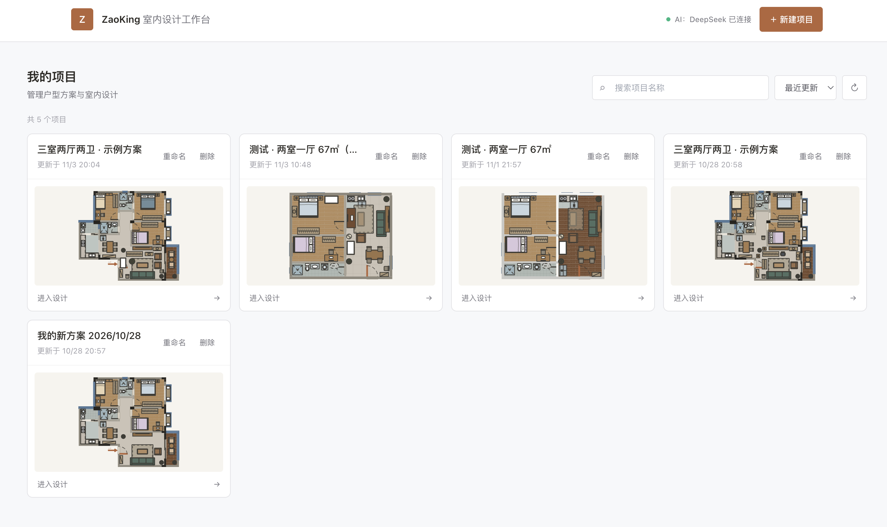
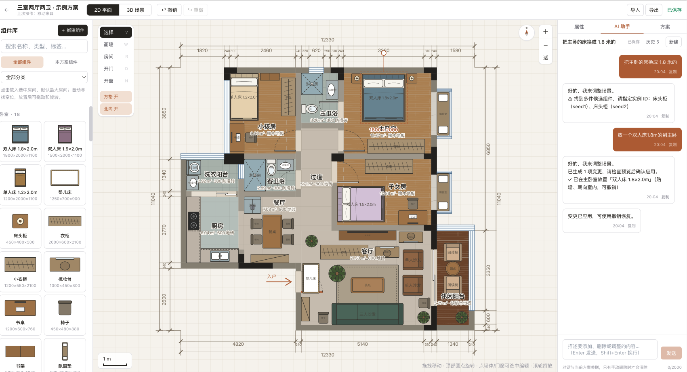
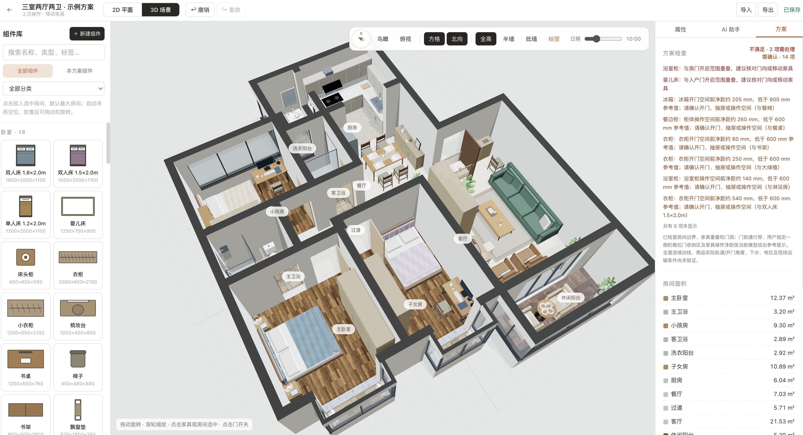
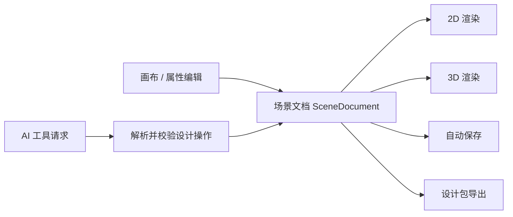

# ZaoKing | AI 辅助室内设计工作台

[English](README.md) · [简体中文](README_ZH.md)

ZaoKing 是一款面向装修业主与独立设计师的 Web 室内设计工具，将户型编辑、家具布置、材质调整和 AI 辅助修改放在同一工作流中。2D 平面图与 3D 场景由同一份结构化设计文档驱动。

> **项目状态：** ZaoKing 仍在积极开发中。本仓库提供可运行的产品原型；功能、数据模型和 API 会随项目迭代调整。

## 产品预览

### 项目工作台

管理设计项目并打开户型编辑器。



### 2D 户型设计

编辑房间、墙体、门窗、尺寸和家具，同时使用 AI 助手提出设计修改。



### 3D 空间预览

在同步的 3D 视图中查看房间结构、家具、材质和空间检查结果。



## 功能概览

- **户型编辑：** 在 2D 画布编辑房间、墙体、门窗、洞口和尺寸标注，并使用网格与朝向标记辅助定位。
- **2D / 3D 联动：** 编辑户型后可查看对应的 3D 空间；两种视图共享同一份设计数据。
- **家具与组件：** 从组件库添加家具，调整位置、朝向、宽度、深度和高度，并修改组件支持的结构参数。
- **AI 设计助手：** 用自然语言提出组件新增、删除、替换、移动、尺寸、颜色或地面材质修改。
- **户型截图识别：** 配置视觉模型后，从上传的户型截图生成草稿，供用户检查和继续编辑。
- **方案检查：** 在布局过程中提示部分家具净空和门扇开启冲突。
- **设计方案：** 保存项目和 AI 对话，并导入或导出参数化设计数据包。
- **3D 材质：** 使用 PBR 地面贴图和 HDRI 环境光改善场景预览效果。

AI 识图和布局检查属于设计辅助功能，不构成尺寸、无障碍、建筑规范、结构安全或施工可行性的认证。购买或施工前，应由专业人员结合现场复核关键尺寸与条件。

## 设计数据与 AI 工作流

编辑器使用结构化的 `SceneDocument` 作为设计数据源，其中包含楼层、墙体、房间、门窗洞口、家具实例，以及可选的项目自定义组件和材质快照。长度使用毫米存储；2D 画布与 Three.js 场景分别将同一文档映射为平面图和 3D 视图。



处理 AI 修改时，服务端会向兼容的大语言模型提供当前房间与组件上下文。模型可以请求新增、改尺寸、删除或换色等定义好的工具；应用再根据组件库解析目标，并校验支持的字段和布局约束后应用操作。户型截图识别是独立的视觉模型流程，返回草稿后由用户复核。

## 技术栈

| 领域 | 技术 |
| --- | --- |
| Web 应用 | Next.js 14 App Router、React 18、TypeScript、Tailwind CSS |
| 场景渲染 | Three.js、React Three Fiber、Drei |
| 前端状态 | Zustand |
| 服务端 API | Next.js Route Handlers |
| 数据持久化 | Prisma ORM，默认使用 SQLite |
| 数据校验 | Zod 与共享场景 / 组件 Schema |
| AI 服务 | DeepSeek 兼容文本 API、可配置视觉模型 API、可选 OpenAI 兼容文本服务 |
| 测试 | Vitest |

## 本地开发

### 环境要求

- Node.js 20 或更新的 LTS 版本
- npm

### 安装启动

```bash
git clone https://github.com/osbrain/ZaoKing.git
cd ZaoKing
cp .env.example .env
npm install
npx prisma db push
npm run dev
```

打开 [http://localhost:3000](http://localhost:3000)。Prisma 默认使用 SQLite，本地数据库文件为 `prisma/dev.db`，已由 Git 忽略规则排除。

### AI 配置

将服务密钥填入本机 `.env`：

```dotenv
DEEPSEEK_API_KEY=你的DeepSeek密钥
VISION_API_KEY=你的视觉模型密钥
```

- `DEEPSEEK_API_KEY` 用于文本设计助手；可通过 `DEEPSEEK_BASE_URL`、`DEEPSEEK_MODEL` 配置地址和模型。
- `VISION_API_KEY` 用于户型截图识别，默认配置面向 Qwen3-VL-Plus；可用 `VISION_BASE_URL`、`VISION_MODEL` 指向其他兼容服务。
- 可选文本服务配置项为 `OPENAI_API_KEY`、`OPENAI_BASE_URL` 和 `OPENAI_MODEL`。
- `DATABASE_URL` 默认值见 `.env.example`。

密钥应保存在本地 `.env` 或部署环境变量中，不要提交 `.env`，也不要在 issue、截图或源码中暴露密钥。AI 功能需要配置对应的服务凭据；其他本地原型功能可以在未配置 AI 时探索。

## 常用命令

```bash
npm run dev        # 启动开发服务
npm run typecheck  # TypeScript 类型检查
npm test           # 运行单元测试
npm run build      # 创建生产构建
npm start          # 启动生产服务
```

开发服务和生产构建共用 `.next` 目录。执行 `npm run build` 前请停止开发服务，构建结束后再重启开发服务。

## 项目结构

```text
src/
  app/                       页面与 API Route Handlers
  core/                      场景文档、Schema、几何、操作和布局校验
  features/                  编辑器、2D / 3D 画布、AI、组件库和属性面板
  lib/                       数据库、AI Provider、API 与自动保存
  stores/                    Zustand 场景和编辑器状态
tests/unit/                  按领域、功能和 API 分组的测试
prisma/                      Prisma Schema 与本地开发数据库
public/textures/              3D 地板与环境贴图
docs/images/                 README 产品截图
```

`src/core` 尽量不依赖 React，使场景 Schema、几何、布局规则和操作能够被编辑器与服务端 AI 工作流共同使用。

## 当前范围与部署说明

本仓库是开发原型，并非已完成生产加固的托管服务。当前默认使用 SQLite。正式部署需要明确数据库与迁移策略、身份认证和项目授权、上传文件存储、备份、可观测性、请求限流，以及 AI 服务的费用和可用性控制。对外开放服务前，应核对部署平台的文件上传和 API 限制。

户型截图导入会依据模型输出生成草稿；请先复核房间边界、尺寸、门和窗。当前空间检查覆盖部分布局约束，不等同于完整的建筑规范检查或施工设计引擎。

## 许可证与素材

ZaoKing 项目代码采用 [Apache License 2.0](LICENSE)。第三方贴图和其他素材可能有独立条款，详见 [`public/textures/README.md`](public/textures/README.md) 及各素材附带的声明。项目许可证不授予第三方品牌或服务的权利。

## 参与贡献

欢迎提交 issue 和 pull request。问题报告请尽量包含受影响的工作流、可复现步骤、预期与实际结果，以及相关浏览器或服务端错误。提交日志或截图前，请移除真实户型、API 密钥和其他隐私信息。
